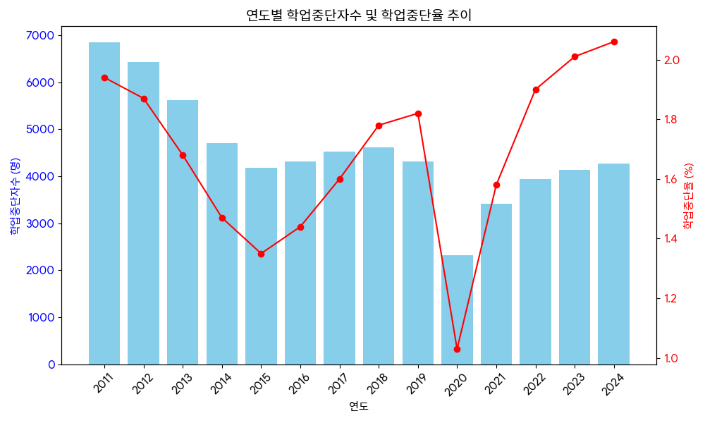

<h2>정리</h2>

2013년 학업중단 숙려제 전면시행에 의해 2015년도까지 약 1.3%로 감소 (Wee 프로젝트 활성화, 숙려기간을 둔 충동적 자퇴 방지, 전문 상담 및 진로 체험 프로그램, 위탁교육 등)
 
2019년 학업중단 숙려제 약화와 대안(취업, 유학 등)의 증가로 약 1.7%로 증가
 
2020년 코로나19로 인한 비대면에 영향(원격 교육, 러프한 교육환경으로 의한 학생 배려)에 의한 약 1.3%로 감소 (일시적 감소)
 
포스트 코로나 이후 대면에 대한 스트레스와 대학교 수시 비중은 감소하고 정시 비중이 증가(20% -> 40% 이상)함에 따른 폭팔적인 증가 약 2%로 증가
 
